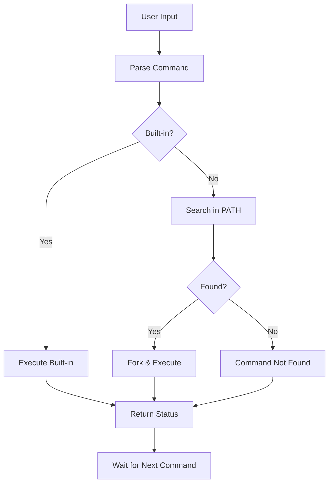
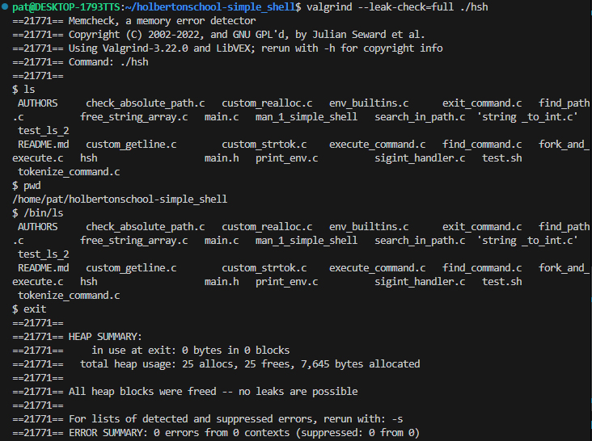
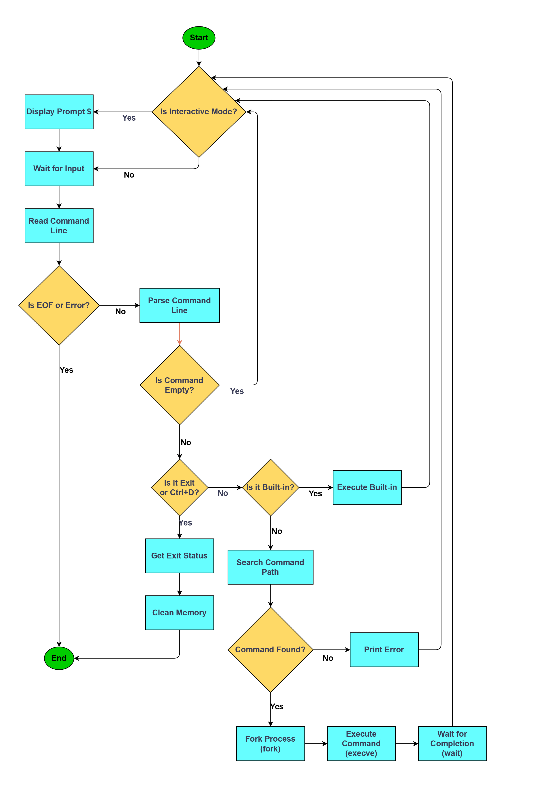

# 🐚 Simple Shell - HSH

[](https://en.wikipedia.org/wiki/C_(programming_language))
[](https://en.wikipedia.org/wiki/ANSI_C)
[](https://www.gnu.org/software/bash/)
[](https://www.holbertonschool.com/)
[](https://github.com/holbertonschool/Betty)

<div align="center">
  
  
  <h2>🚀 A UNIX Command Line Interpreter</h2>
  <p><em>Built from scratch in C as part of the Holberton School curriculum</em></p>
  <p><strong>Release Date:</strong> January 10, 2025</p>
</div>

## 📋 Table of Contents
- [🎯 Overview](#-overview)
- [✨ Features](#-features)
- [🔧 Requirements](#-requirements)
- [📦 Installation](#-installation)
- [🎮 Usage](#-usage)
- [🛠️ Built-in Commands](#️-built-in-commands)
- [🏗️ Architecture](#️-architecture)
- [🧪 Testing](#-testing)
- [📁 Project Structure](#-project-structure)
- [📖 Manual Page](#-manual-page)
- [🤝 Contributing](#-contributing)
- [👥 Authors](#-authors)

## 🎯 Overview

**Simple Shell (hsh)** is a lightweight UNIX command line interpreter that replicates the core functionality of the `/bin/sh` shell. This project demonstrates mastery of system programming concepts including process management, memory allocation, signal handling, and UNIX system calls.

### 🚀 What is a Shell?

A shell is a command-line interface that acts as an intermediary between the user and the operating system kernel. It interprets user commands, either interactively (typed directly into the terminal) or non-interactively (read from a script), and translates them into system calls that the operating system can understand and execute.

## ✨ Features

- 🖥️ **Interactive Mode** - Displays prompt and waits for user input
- 📜 **Non-Interactive Mode** - Executes commands from scripts or pipes
- 🔍 **PATH Resolution** - Automatically searches for commands in PATH directories
- 🏠 **Built-in Commands** - Implements essential shell built-ins (`exit`, `env`, `cd`, `setenv`, `unsetenv`)
- 🔧 **Environment Management** - Full environment variable support
- 🚫 **Signal Handling** - Proper handling of Ctrl+C (SIGINT)
- 💾 **Memory Management** - Zero memory leaks with proper cleanup
- ⚡ **Error Handling** - Comprehensive error reporting and status codes
- 📏 **Betty Compliant** - Follows Holberton School's coding standards

## 🔧 Requirements

### 🖥️ System Requirements
| Component | Specification |
|-----------|---------------|
| **OS** | Ubuntu 20.04 LTS |
| **Compiler** | GCC with flags: `-Wall -Werror -Wextra -pedantic` |
| **Standard** | C89/C90 |
| **Style** | Betty coding style |
| **Memory** | No memory leaks allowed |

### 📚 Allowed Functions
<details>
<summary>Click to expand function list</summary>

| System Calls | Library Functions | Process Functions |
|-------------|-------------------|-------------------|
| • `access` | • `fflush` | • `execve` |
| • `chdir` | • `free` | • `fork` |
| • `close` | • `getline` | • `getpid` |
| • `closedir` | • `malloc` | • `kill` |
| • `open` | • `perror` | • `wait` |
| • `opendir` | • `printf` | • `waitpid` |
| • `read` | • `fprintf` | • `wait3` |
| • `write` | • `sprintf` | • `wait4` |
| • `signal` | • `putchar` | • `_exit` |
| • `getcwd` | • `readdir` | • `exit` |
| • `isatty` | • `stat` | • `vfprintf` |
| • `lstat` | • `fstat` | • `strtok` |
| • `stat` | • `strcat` | • `strcmp` |
| • `strlen` | • `strcpy` | • `strncmp` |
| • `strncpy` | • `strstr` | • `strncat` |

</details>

## 📦 Installation

### 1. Clone the Repository
```bash
git clone https://github.com/Pmichel74/holbertonschool-simple_shell.git
cd holbertonschool-simple_shell
```

### 2. Compile the Shell
```bash
gcc -Wall -Werror -Wextra -pedantic *.c -o hsh
```

### 3. Run the Shell
```bash
# Interactive mode
./hsh

# Non-interactive mode
echo "ls -la" | ./hsh
```

## 🎮 Usage

### Interactive Mode
```bash
$ ./hsh
($) ls -l
total 100
-rwxr-xr-x 1 user user 18816 Jan 10 10:30 hsh
-rw-r--r-- 1 user user  1234 Jan 10 10:25 main.c
($) pwd
/home/user/simple_shell
($) exit
$
```

### Non-Interactive Mode
```bash
$ echo "pwd" | ./hsh
/home/user/simple_shell
$ cat commands.txt | ./hsh
Hello World!
/home/user/simple_shell
```

### Command Examples
```bash
# Basic commands
($) ls
($) pwd
($) echo "Hello World"

# Commands with arguments
($) ls -la /tmp
($) grep "pattern" file.txt

# Built-in commands
($) env
($) exit 0
($) cd /home
($) setenv VAR value
($) unsetenv VAR
```

## 🛠️ Built-in Commands

| Command | Syntax | Description |
|---------|--------|-------------|
| `exit` | `exit [status]` | Exit the shell with optional status code |
| `env` | `env` | Print all environment variables |
| `cd` | `cd [directory]` | Change current directory |
| `setenv` | `setenv VARIABLE VALUE` | Set environment variable |
| `unsetenv` | `unsetenv VARIABLE` | Remove environment variable |

### Examples
```bash
($) exit 98                 # Exit with status 98
($) env                     # Display environment
($) cd /tmp                 # Change to /tmp directory
($) setenv USER john        # Set USER variable
($) unsetenv PATH           # Remove PATH variable
```

## 🏗️ Architecture

### 🔄 Execution Flow



### 🧩 Core Components

#### Main Loop (`main.c`)
- **Purpose:** Program entry point and main execution loop
- **Key Functions:** Input reading, command processing, cleanup

#### Command Processing (`tokenize_command.c`)
- **Purpose:** Parse input into command and arguments
- **Features:** Handles spaces, tabs, and special characters

#### Path Resolution (`find_command.c`, `search_in_path.c`)
- **Purpose:** Locate executable files in PATH directories
- **Features:** Absolute/relative path handling, PATH traversal

#### Execution Engine (`execute_command.c`, `fork_and_execute.c`)
- **Purpose:** Create child processes and execute commands
- **Features:** Process management, error handling, status tracking

#### Built-in Handlers (`env_builtins.c`, `exit_command.c`, `cd_command.c`)
- **Purpose:** Implement shell built-in commands
- **Features:** Environment manipulation, directory navigation

## 🧪 Testing

### Manual Testing
```bash
# Test basic commands
./hsh
($) ls
($) pwd
($) echo "test"

# Test PATH resolution
($) /bin/ls
($) which ls

# Test built-ins
($) env
($) exit 0
```

### Automated Testing
```bash
# Compare with /bin/sh
echo "ls" | ./hsh > output1
echo "ls" | /bin/sh > output2
diff output1 output2
```

### Memory Testing
```bash
valgrind --leak-check=full --show-leak-kinds=all ./hsh
```



## 📁 Project Structure

```
holbertonschool-simple_shell/
├── 📄 main.h                    # Header with prototypes and includes
├── 📄 main.c                    # Program entry point and main loop
├── 📄 AUTHORS                   # Project contributors
├── 📄 man_1_simple_shell        # Manual page
├── 📁 Core Functions/
│   ├── 📄 execute_command.c     # Command execution handler
│   ├── 📄 fork_and_execute.c    # Process creation and execution
│   ├── 📄 tokenize_command.c    # Command parsing and tokenization
│   └── 📄 sigint_handler.c      # Signal handling (Ctrl+C)
├── 📁 Path Management/
│   ├── 📄 find_command.c        # Command location in PATH
│   ├── 📄 find_path.c           # PATH environment handling
│   ├── 📄 search_in_path.c      # PATH directory traversal
│   └── 📄 check_absolute_path.c # Absolute/relative path validation
├── 📁 Built-in Commands/
│   ├── 📄 exit_command.c        # Exit built-in implementation
│   ├── 📄 cd_command.c          # Directory navigation
│   ├── 📄 env_builtins.c        # Environment variable management
│   └── 📄 print_env.c           # Environment display
├── 📁 Utilities/
│   ├── 📄 custom_getline.c      # Custom input reading
│   ├── 📄 custom_strtok.c       # Custom string tokenization
│   ├── 📄 string_to_int.c       # String to integer conversion
│   └── 📄 free_string_array.c   # Memory management
├── 📁 Documentation/
│   ├── 📄 README.md             # This file
│   └── 📁 img/                  # Documentation images
└── 📄 hsh                       # Compiled executable
```

### 📊 Function Flow Diagram



## 📖 Manual Page

Access the complete manual page:
```bash
man ./man_1_simple_shell
```

The manual includes:
- **Synopsis** - Command syntax and options
- **Description** - Detailed functionality explanation
- **Built-in Commands** - Complete command reference
- **Environment** - Environment variable usage
- **Exit Status** - Return code explanations
- **Examples** - Usage scenarios and command samples

## 🤝 Contributing

This project follows strict Holberton School standards:

### 📝 Coding Standards
- ✅ **Betty Style** - All code must pass Betty style checks
- ✅ **Maximum 5 Functions** - Per file limitation
- ✅ **Include Guards** - All header files protected
- ✅ **No Memory Leaks** - Validated with Valgrind
- ✅ **Error Handling** - Comprehensive error management

### 🔍 Code Review Process
1. **Style Check:** `betty-style.pl *.c`
2. **Documentation:** `betty-doc.pl *.c`
3. **Memory Test:** `valgrind --leak-check=full ./hsh`
4. **Functionality:** Compare output with `/bin/sh`

## 📜 License

This project is part of the Holberton School curriculum and is intended for educational purposes.

## 👥 Authors

<div align="center">

| Author | Role | GitHub | Email |
|--------|------|--------|-------|
| **Patrick Michel** | Lead Developer | [@Pmichel74](https://github.com/Pmichel74) | patrick.yann.michel@gmail.com |
| **Benjamin Ristord** | Co-Developer | [@jbn179](https://github.com/jbn179) | 9772@holbertonstudents.com |

</div>

---

<div align="center">

**🎓 Holberton School - System Programming Project**

*Building the future, one line of code at a time*

[](https://www.holbertonschool.com/)
[](https://github.com/Pmichel74/holbertonschool-simple_shell)

**⭐ If you found this project helpful, please give it a star! ⭐**

</div>
